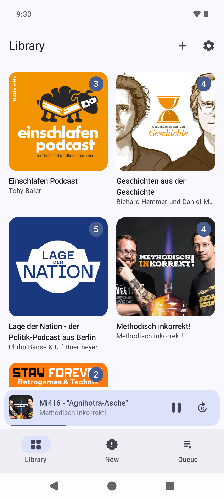
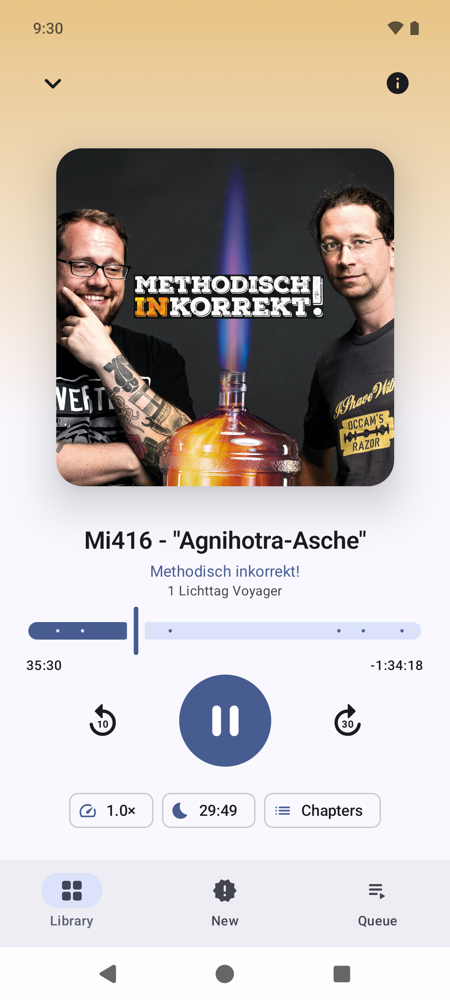
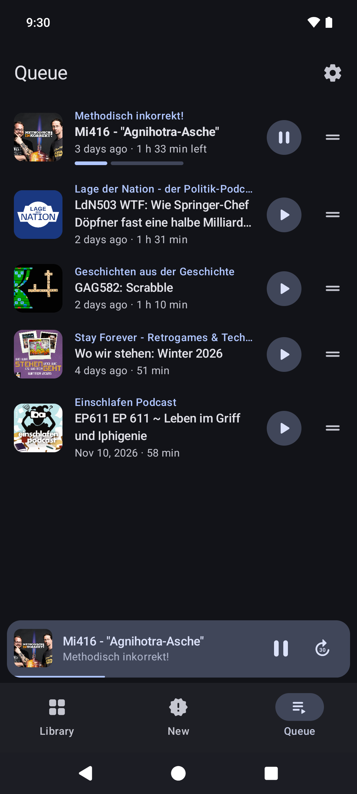
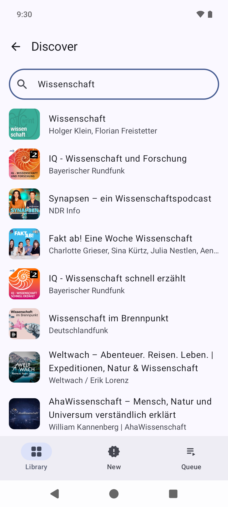

# Brabbely

A podcast app for Android: simple, free and without tracking. Brabbely plays audio and video
podcasts, keeps your queue in order and makes falling asleep to a podcast easy.

## Features

- Search for podcasts or add any RSS feed
- Audio and video, video in full screen and picture-in-picture
- Queue, playback speed, skip silence and chapters with images
- Downloads of new episodes, only on Wi-Fi if you like; played episodes are deleted
- A sleep timer that fades out, can start by itself at night and starts over when you shake
  the phone
- Moving over from AntennaPod with what you have played, or from any app via OPML
- Daily backups to a folder of your choice
- English and German, Material You colors

## Privacy

No ads, no tracking, no account and no Google Play Services. Brabbely only talks to the
servers of your podcasts, and to Apple's podcast directory when you search.

## Install

Brabbely needs Android 8.0 or newer. APKs are published on the
[releases page](https://github.com/sj14/brabbely/releases).

## License

[GPL-3.0](LICENSE). Building and contributing: see [DEVELOPMENT.md](DEVELOPMENT.md).
